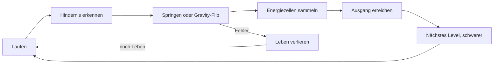

# Game Design Document: Flip Bot

**Autor:** <dein GitHub-Name>
**Mein Anteil:** gesamtes GDD (docs/GDD.md, docs/ASSETS.md, Ordnerstruktur), Commits unter meinem GitHub-Namen

## 1. Titel & Pitch
**Titel:** Flip Bot
**Pitch:** Ein kleiner Roboter rennt durch eine kaputte Fabrik und dreht per Knopfdruck die Schwerkraft um, damit er an der Decke weiterlaufen kann.

## 2. Genre, Plattform, Zielgruppe
- Genre: Jump & Run (Plattformer), 2D
- Plattform: PC (Windows/macOS) und Web-Export
- Zielgruppe: Jugendliche und Gelegenheitsspieler ab 10 Jahren, die kurze Levels mögen
- Spielzeit: ca. 10–15 Minuten für alle 3 Levels

## 3. Spielidee & Core Loop
Der Spieler läuft automatisch nach rechts, springt über Lücken und flippt die Schwerkraft, um Hindernissen auszuweichen. Auf Boden und Decke liegen Energiezellen. Wer alle Zellen eines Levels sammelt, bekommt eine Bonuswertung. Das Level endet am Ausgang.

**Twist:** Der Boden ist nicht immer sicher. Oft ist der Weg nur an der Decke frei, und man muss im richtigen Moment flippen.



## 4. Steuerung
| Aktion | Tastatur | Gamepad |
|---|---|---|
| Links/Rechts bewegen | A/D oder Pfeiltasten | Linker Stick |
| Springen | Leertaste | A-Taste |
| Schwerkraft flippen | F oder Shift | X-Taste |
| Pause | Esc | Start |

Der Flip hat 0,5 Sekunden Abklingzeit und funktioniert nur am Boden oder an der Decke, nicht in der Luft.

## 5. Regeln, Sieg und Niederlage
- **Sieg:** Ausgang des Levels erreichen. Nach Level 3 ist das Spiel gewonnen.
- **Niederlage:** Alle 3 Leben sind weg (Game Over).
- **Leben verlieren:** Stacheln berühren, in den Abgrund fallen, von einem Gegner getroffen werden.
- **Respawn:** Am letzten Checkpoint (Flagge).
- **Punkte:** Energiezelle = 10 Punkte, Level-Abschluss = 100 Punkte, Zeitbonus bei schneller Zeit.

## 6. Gegner & Herausforderungen
| Name | Verhalten |
|---|---|
| Patrouillen-Bot | Läuft auf einer Plattform hin und her, dreht an Kanten um. Schaden bei Berührung. Kann nicht besiegt werden, man weicht aus. |
| Laser-Turm | Schießt alle 2 Sekunden einen Laser in eine feste Richtung. Man muss den Rhythmus lernen. |
| Stacheln | Statische Falle am Boden oder an der Decke. Sofortiger Lebensverlust. |
| Fallende Plattform | Bricht 1 Sekunde nach Betreten ab. Man muss schnell weiter. |

## 7. Fortschritt & Schwierigkeit
- **Level 1 "Werkstatt":** Nur Springen, Stacheln und Patrouillen-Bots. Der Gravity-Flip wird erklärt.
- **Level 2 "Fließband":** Flip-Passagen, fallende Plattformen, erste Laser-Türme.
- **Level 3 "Reaktorkern":** Schnelle Flip-Kombinationen, mehrere Laser, weniger Checkpoints.
- Die Laufgeschwindigkeit steigt pro Level um ca. 10 %.

## 8. Benutzeroberfläche
Handskizzen für alle Screens liegen in `docs/ui/` (Fotos). Textskizzen dazu:

**Hauptmenü**
```
+----------------------+
|      FLIP BOT        |
|      [ Start ]       |
|   [ Einstellungen ]  |
|      [ Beenden ]     |
+----------------------+
```

**HUD**
```
+------------------------------+
| Leben: 3   Zellen: 3/10  Pkt |
|                              |
|        (Spielfeld)           |
+------------------------------+
```

**Pausemenü:** Fortsetzen, Neustart, Hauptmenü

**Game Over:** Text "Game Over", erreichte Punkte, Buttons Nochmal und Hauptmenü

**Einstellungen:** Lautstärke Musik, Lautstärke Effekte, Vollbild an/aus, Zurück

## 9. Visueller Stil & Audio
- **Stil:** Pixel-Art mit leuchtenden Neon-Akzenten auf dunklem Industrie-Hintergrund. Stimmung: spannend, aber verspielt.
- **Moodboard (Bilder liegen in `docs/moodboard/`):**
  1. Kenney "Platformer Pack" (kenney.nl)
  2. Kenney "Pixel Platformer Industrial Expansion" (kenney.nl)
  3. Referenz: Celeste (Pixel-Look)
  4. Referenz: VVVVVV (Gravity-Flip-Idee)
- **Farbpalette:**

| Farbe | Hex | Verwendung |
|---|---|---|
| Dunkelblau | #1B1F3B | Hintergrund |
| Neon-Cyan | #00E5FF | Spieler, Energiezellen |
| Orange | #FF8A00 | Gegner, Stacheln |
| Hellgrau | #D9DCE3 | Plattformen, Text |

- **Musik:** Retro-8-Bit-Synthwave, schnell und treibend
- **Sounds:** Sprung-Blip, Flip-Whoosh, Einsammel-Ping, Laser-Zap, Game-Over-Jingle

## 10. Umfang & Zeitplan (MoSCoW)
| Priorität | Inhalt |
|---|---|
| **Must** | Laufen, Springen, Gravity-Flip, 1 Level, 2 Gegnertypen/Hindernisse, Leben, Hauptmenü, Game Over |
| **Should** | 3 Levels, Energiezellen und Punkte, Checkpoints, HUD, Pausemenü, Musik und Sounds |
| **Could** | Zeitbonus, Highscore-Speicherung, Partikeleffekte, Gamepad-Support |
| **Won't** | Online-Multiplayer, Level-Editor, Bossgegner, Story-Cutscenes |

| Aufgabe | Inhalt |
|---|---|
| 15.11 | Projekt-Setup, Spieler-Bewegung, Springen, Gravity-Flip |
| 15.12 | Level 1 bauen, Hindernisse (Stacheln, Abgründe) |
| 15.13 | Gegner (Patrouillen-Bot, Laser-Turm) |
| 15.14 | HUD, Leben, Punkte, Checkpoints |
| 15.15 | Menüs (Haupt-, Pause-, Game Over, Einstellungen) |
| 15.16 | Sound, Musik, Optik, Level 2 und 3 |
| 15.17 | Bugfixing, Spielgefühl, Export und Veröffentlichung |

## Risiken
- **Gravity-Flip fühlt sich schlecht an** → Plan B: Flip nur an markierten Flip-Zonen erlauben.
- **Zu wenig Zeit für 3 Levels** → Plan B: 2 Levels, dafür sauber.
- **Assets passen nicht zusammen** → Plan B: nur Kenney-Assets verwenden und einfärben.
- **Export im Web funktioniert nicht** → Plan B: Windows/macOS-Export abgeben.

## Technik
- Engine: Godot 4.3 (GDScript)
- Version Control: Git/GitHub
